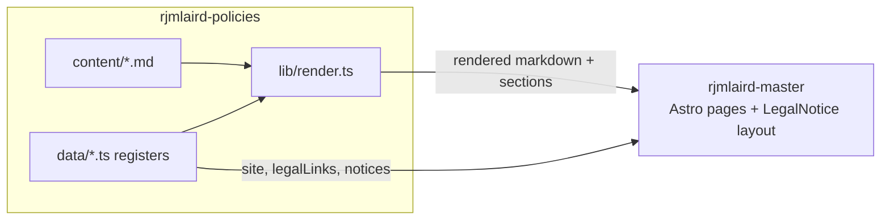

# Data flow

How personal data moves through the rjmlaird estate, and how this package moves into the site.
Providers marked *(confirm)* are seeded in `data/processors.ts` as `unconfirmed`. Fix this diagram and
the register together.

## 1. Personal data

```mermaid
flowchart LR
  V[Visitor / enquirer / client]

  subgraph Edge["Cloudflare (confirm)"]
    W[rjmlaird.co.uk]
    B[booking.rjmlaird.co.uk]
    H[hooks.rjmlaird.co.uk<br/>webhook gateway]
  end

  V -->|page requests, IP, logs| W
  V -->|enquiry form| F[Fillout (confirm)]
  V -->|book a session| C[Cal.com (confirm)]
  V -->|pay| S[Stripe (confirm)]
  B --- C
  B --- S

  F -->|events| H
  C -->|events| H
  S -->|events| H
  H --> CRM[HubSpot (confirm)]
  H --> N[Notion (confirm)]
  H -.->|queue / store| Q[(Edge queue + database)]

  V -->|email| E[Email + calendar provider (TBC)]
  S -->|payment records| A[Accounting provider (TBC)]
  V -.->|opt-in| NL[Newsletter provider (TBC)]
  W -.->|consent-based| AN[Analytics provider (TBC)]
```

Questions this diagram should answer before the privacy notice is published:

- Does the gateway store event payloads (names, emails, booking notes)? If so they are personal data
  with their own retention period (`retention.ts`) and the hosting provider is a processor for them.
- Which notice covers `booking.rjmlaird.co.uk`: this one, or its own? The privacy notice currently says
  the booking portal "may provide additional privacy information".
- Where does each provider store data, and under what transfer safeguard?

## 2. How the package reaches the site



Content references data with `{{site.x}}` and `{{include:name}}`. Rendering happens in
`renderPolicyMarkdown()`; the site only supplies the layout and a markdown processor.
